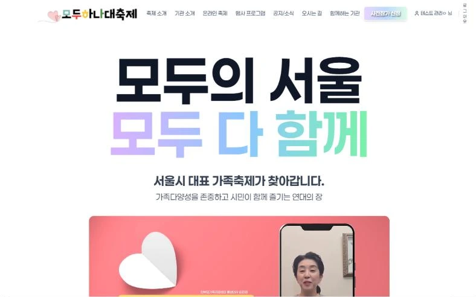
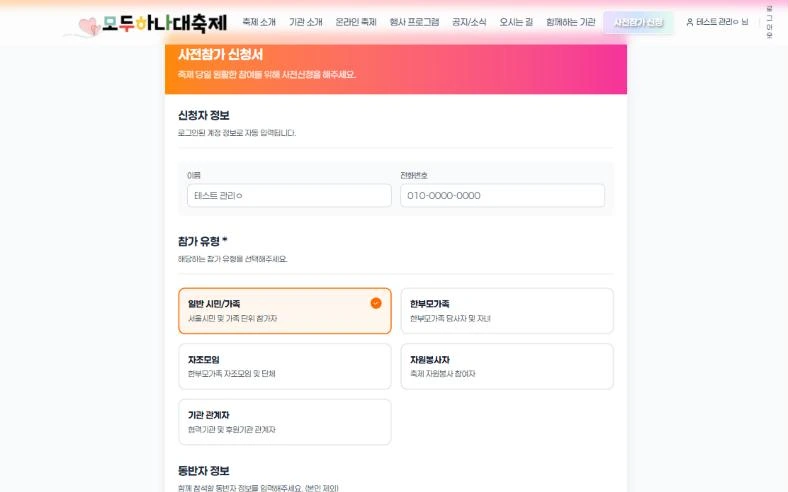
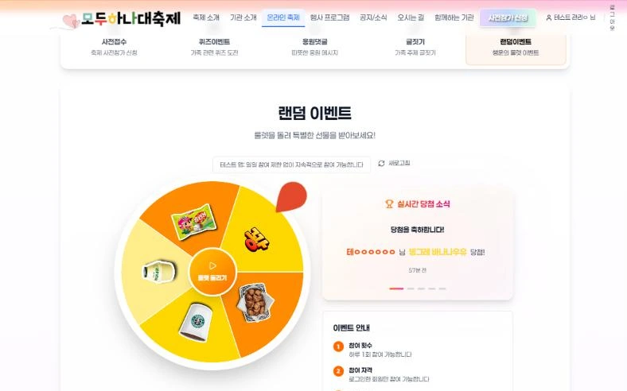
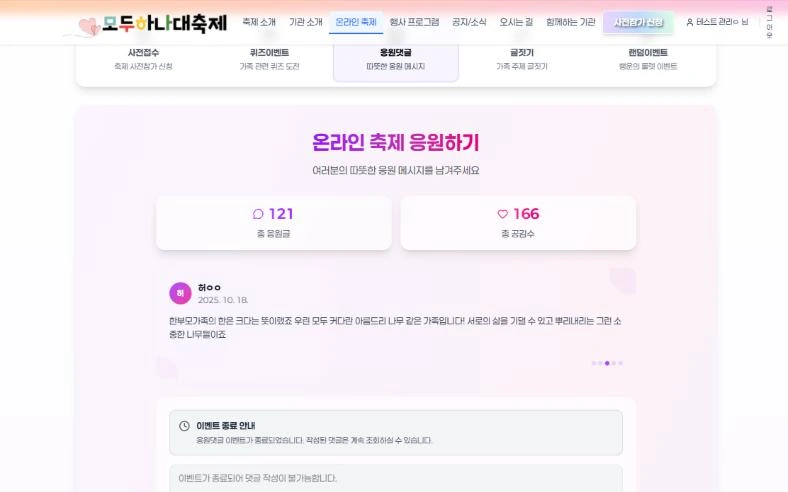
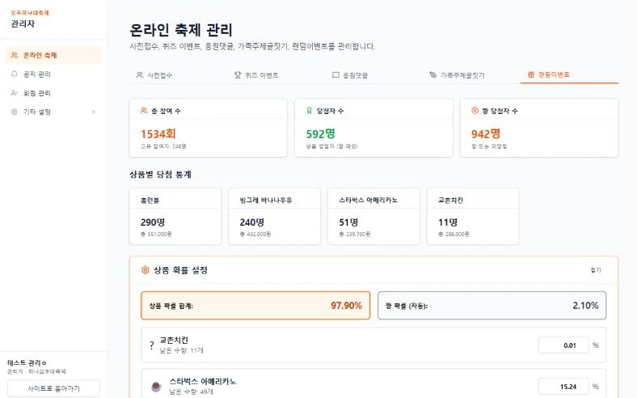
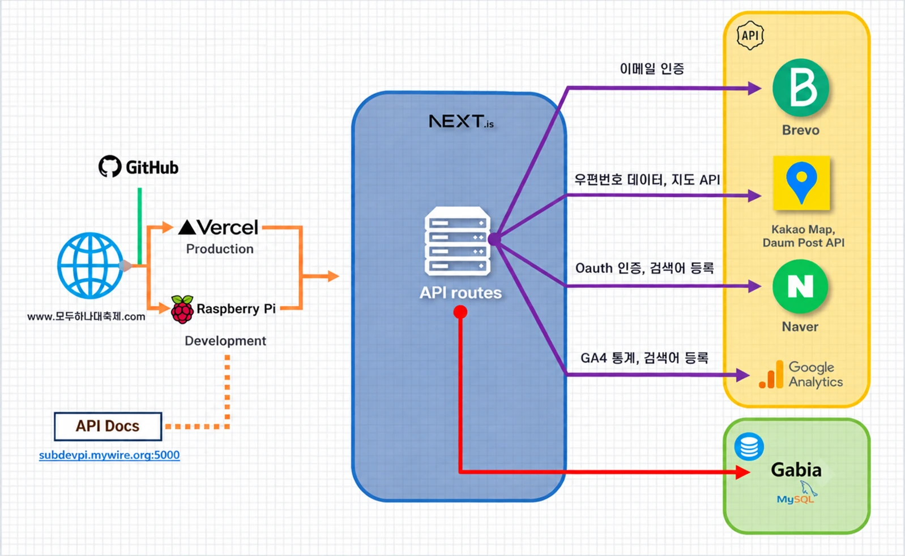

# 2025 모두하나대축제 온라인 참여 플랫폼

> 한부모가족 축제의 사전접수, 온라인 이벤트(퀴즈, 룰렛, 응원 댓글, 글짓기), 공지, 관리자 화면



## 1. 개요

| 항목 | 내용 |
|---|---|
| 기간 | 2025.09 ~ 10 (약 1개월) |
| 주최, 주관 | 서울특별시 / 서울특별시한부모가족지원센터 |
| 참여 | 개발 1명 |
| 담당 | 프론트엔드, 백엔드, 배포 |
| 기술 | Next.js 15, React 19, TypeScript, Tailwind CSS 4, React Hook Form, Zod, MySQL, Naver OAuth, Brevo(이메일), Vercel |
| 링크 | [데모](https://hana-modoo-fest.vercel.app/), [상세 설명](https://subdevpi.mywire.org/portfolio/모두하나대축제) |

이 저장소는 행사 종료 후 정리한 데모 버전입니다. 행사 기간에 쓰던 Redis는 데모 버전에서 뺐습니다.

## 2. 화면

| 사전참가 신청 | 온라인 축제 (룰렛) |
|---|---|
|  |  |
| 로그인 정보로 신청자 정보를 채우고 참가 유형, 동반자 수 입력 | 하루 한 번 참여하는 경품 이벤트 |

| 응원 댓글 | 관리자 경품 이벤트 |
|---|---|
|  |  |
| 200자 응원 메시지, 좋아요, 정렬 | 상품별 확률을 넣으면 꽝 확률은 나머지로 자동 계산 |

## 3. 주요 기능

- 회원가입, 로그인: 이메일 인증 가입, 네이버 로그인, 비밀번호 찾기
- 사전참가 신청: 여러 단계로 나눈 신청 폼, 주소 검색 연동, 신청 후 참가증 확인
- 온라인 축제: 퀴즈, 룰렛 경품 이벤트, 응원 댓글, 가족 주제 글짓기
- 공지와 소식: 카테고리별 목록, 상세 페이지
- 관리자: 회원 검색과 Excel 내보내기, TipTap 에디터로 소식 작성, 경품 확률과 재고 설정, 당첨자 관리

## 4. 구성



```
src/app/
├── (site)/        사용자 페이지
├── (dashboard)/   관리자 페이지
└── api/           API Route
src/lib/
├── mysql/         커넥션 풀, 쿼리 함수
├── auth/          세션 확인
├── email/         Brevo 인증 메일, 허용 도메인 검사
└── services/      회원, 소식, 캠페인 통계 조회
```

운영 배포는 Vercel, 기관 담당자 확인용 개발 브랜치는 홈서버(라즈베리파이)에 따로 올렸습니다.

## 5. 기술 선택

| 기술 | 고른 이유 |
|---|---|
| Next.js (API Route 포함) | 화면과 API를 한 프로젝트에서 관리해 1명이 1개월 안에 만들 수 있는 구성으로 잡았습니다. |
| 서버 세션 로그인 | 다른 기기에서 로그인하면 기존 기기를 바로 끊어야 했는데, 서버가 로그인 상태를 직접 갖고 있어야 가능해서 DB에 세션 토큰을 저장하는 방식을 골랐습니다. |
| MySQL 트랜잭션 | 경품 재고처럼 여러 명이 동시에 바꾸는 값을 안전하게 차감해야 했습니다. |

## 6. 구현하며 고려한 점

### 6-1. 경품 재고 차감

하루 한 번 참여하는 룰렛 이벤트에서, 남은 수량이 0보다 클 때만 1을 빼는 조건부 UPDATE를 MySQL 트랜잭션 안에서 실행했습니다. 바뀐 행이 없으면 롤백해서 수량보다 많이 나가지 않게 했습니다. 당첨 결과는 서버에서 먼저 정하고, 화면은 룰렛 애니메이션만 재생합니다.

```sql
UPDATE prizes
   SET current_quantity = current_quantity - 1
 WHERE id = ?
   AND current_quantity > 0;
-- affectedRows가 0이면 롤백
```

### 6-2. 중복 가입 방지

운영 중 같은 IP에서 비슷한 아이디로 가입하고 바로 탈퇴하는 패턴이 보여서 아래 규칙을 추가했습니다.

- 허용한 이메일 도메인(Gmail, Naver, Daum 등)만 가입 가능. 가입 화면에 허용 도메인 안내
- 연락처와 이메일의 해시 값을 기존 기록과 대조
- 24시간 안에 10번 넘게 가입을 시도한 IP는 차단
- 탈퇴 후 12시간은 다시 가입할 수 없음

### 6-3. 중복 로그인 방지

- DB에 세션 토큰과 만료 시각을 저장하고 `httpOnly` 쿠키로 전달합니다.
- 다른 기기에서 로그인하면 기존 세션이 끝나고, 끊긴 기기는 안내 메시지와 함께 로그인 화면으로 이동합니다.

## 7. 결과

- 사전접수와 온라인 참여(퀴즈, 룰렛, 응원 댓글, 글짓기) 약 400명 규모의 행사를 중단 없이 운영했습니다.

## 8. 실행 방법

```bash
npm install
npm run dev
```

`.env.local`에 아래 값이 필요합니다. (커밋하지 않음)

| 항목 | 용도 |
|---|---|
| `MYSQL_HOST`, `MYSQL_PORT`, `MYSQL_USER`, `MYSQL_PASSWORD`, `MYSQL_DATABASE` | MySQL 접속 정보 (서버에서만 사용) |
| `NAVER_CLIENT_ID`, `NAVER_CLIENT_SECRET` | 네이버 로그인 |
| `NEXT_PUBLIC_KAKAO_JS_KEY` | 오시는 길 지도 |
| `BREVO_API_KEY`, `BREVO_SENDER_EMAIL`, `BREVO_SENDER_NAME` | 가입 인증 메일 |
| `NEXT_PUBLIC_RECAPTCHA_SITE_KEY`, `RECAPTCHA_SECRET_KEY` | 봇 방지 |

## 9. 회고

AI 페어 프로그래밍을 처음 도입한 프로젝트였습니다. 일정이 빠듯해 디자인 시안이 없는 페이지를 AI로 급하게 채웠고, 그 화면들이 그대로 들어간 점은 아쉽습니다. 이후 프로젝트부터는 화면을 직접 설계하거나 요구사항을 더 구체적으로 주는 방식으로 바꿨습니다.
